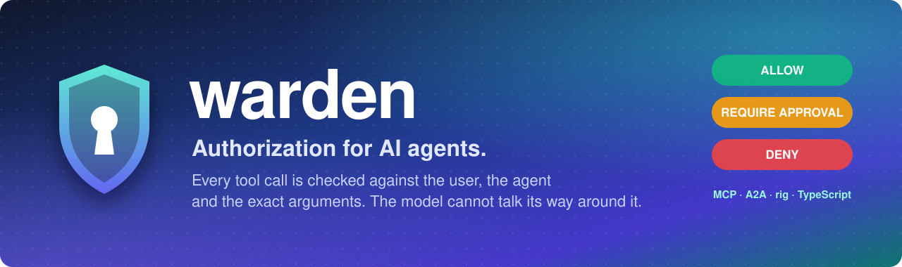
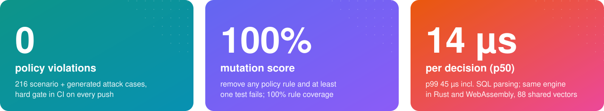
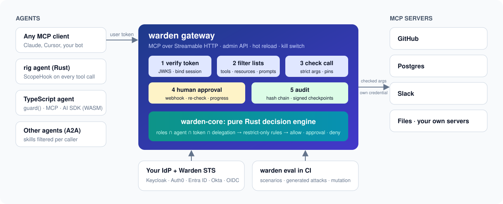
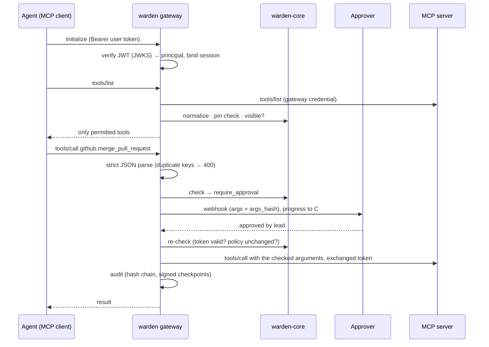

<p align="center">
  
</p>

<p align="center">
  <a href="https://github.com/byQuexo/warden/actions/workflows/ci.yml"></a>
  
  
  
  <a href="#license"></a>
</p>

<p align="center">
  
  <br>
  <sub>From CI on every push: the <a href="examples/devtools/eval/reference.yaml">devtools</a> and <a href="examples/acme/eval/reference.yaml">acme</a> scenario suites plus attacks generated from each policy (<code>warden eval --generate --mutate --coverage --gate</code>). Latency from <code>warden bench</code>, release build, one core. → <a href="#results">Results</a> · <a href="#learnings">Learnings</a></sub>
</p>

## Try it

```bash
git clone https://github.com/byQuexo/warden && cd warden
cargo run -p warden-cli -- demo
```

One command boots an OIDC token service, MCP servers for **GitHub, Postgres, Slack and workspace files**,
an approval webhook and the gateway, then plays through what a coding agent tries to do, with
real tokens over real HTTP:

```text
1  The coding agent only sees the tools its user may use (tools/list is filtered)
   vic    viewer      github.list_issues, postgres.query
   dana   developer   github.create_issue, github.list_issues, github.merge_pull_request, postgres.query
   mo     maintainer  github.create_issue, github.list_issues, github.merge_pull_request, postgres.query
   mo may delete repos and post to Slack, but not through the coding agent (agent ceiling)

2  Arguments are checked, not just tool names
   dana   github.create_issue {owner: someone-else}                    DENY     own-orgs-only
   dana   github.create_issue {owner: "acme-dev​"}                DENY     own-orgs-only
   dana   postgres.query "…; DROP TABLE deployments"                   DENY     read-only-sql
   dana   postgres.query "SELECT … FROM users"                         DENY     read-only-sql

3  Prompt injection cannot widen rights
   mo     github.delete_repo (never listed, called anyway)             DENY     scope.missing

4  Human in the loop for risky writes
   dana   github.merge_pull_request {number: 42}                       APPROVAL
            ↳ approved by lead@acme-dev, re-checked, forwarded         ALLOW

5  Files: workspace yes, secrets no
   dana   resources/read file:///workspace/.env                        DENY     scope.missing
   dana   resources/read file:///workspace/../etc/passwd               DENY     normalize.uri

6  Supply chain: an MCP server silently changes a tool
   dana   github.create_issue (description changed; listed: false)     DENY     catalog.unpinned

8  Evidence
   audit log: 18 events, 2 signed checkpoints — chain verified ✔
   MCP servers received 4 calls, none with a user's token — token passthrough: none ✔
```

## Three ways to use it

| Gateway, no code | Rust, in-process | TypeScript, in-process |
|---|---|---|
| Put `warden-gateway` in front of the MCP servers you already run. Agents connect with the user's OAuth token. [Quickstart](#quickstart) | `warden-core` in your own loop, `ScopeHook` for [rig](https://github.com/0xPlaygrounds/rig) agents, `warden-a2a` for agent-to-agent calls. [Rust guide](docs/consuming.md#2-rust-in-process) | The same engine as WebAssembly: `guard()` any function, wrap your MCP server, or filter Vercel AI SDK tools. [TS guide](packages/warden/README.md) |

Nothing in the core knows about GitHub, HR or any other domain: actions, roles, scopes,
agents and attributes all come from your YAML. Custom action kinds (`x-payment`, `x-shell`, …)
work exactly like tools.

## What makes it different

Most agent frameworks hand every tool to every user and hope the prompt holds. Warden
answers *may this agent, acting for this user, do this exact thing right now?* in code:

```text
effective = user roles ∩ agent ceiling ∩ token scopes ∩ every agent in the delegation chain
decision  = scope gate → rules that can only restrict → allow | require_approval | deny
```

A policy is three small YAML files. Here is the heart of [`examples/devtools`](examples/devtools):

```yaml
# catalog.yaml: what exists and what it needs. Anything not listed is denied.
tool:
  github.create_issue:       { scopes: [github:write], sensitivity: write }
  github.merge_pull_request: { scopes: [github:write], sensitivity: write, tags: [release] }
  postgres.query:            { scopes: [db:read] }

# policy.yaml: roles grant scopes, agents have a ceiling, rules only ever restrict.
roles:
  developer: [github:read, github:write, db:read]
agents:
  coding-agent: { max: [github:read, github:write, db:read] }
rules:
  - id: own-orgs-only
    match: { kind: tool, name: "github.*" }
    require: { arg: owner, in: "{subject.attrs.orgs}" }
  - id: merges-need-approval
    match: { tag: release }
    approve_if: always
  - id: read-only-sql
    match: { kind: tool, name: postgres.query }
    require: { arg: sql, sql: { dialect: postgres, tables_allow: [issues, deployments] } }
```

Every decision can be explained, and the model only ever sees a generic sentence:

```text
$ warden explain --principal @dana.json --action tool:github.create_issue --args '{"owner":"someone-else","repo":"api","title":"x"}'
effect: deny
rule:   own-orgs-only
trace:
  normalize              ok         tool github.create_issue
  principal              ok         subject=dana agent=coding-agent
  catalog                ok         needs [github:write] sensitivity=Write tags=[]
  scope_gate             ok         github:write
  rule:own-orgs-only     deny       require — required condition does not hold
model sees: This action is not permitted.
```

## Architecture



One pure Rust engine, no I/O and no clock, is shared by every entry point. The gateway adds
identity, sessions, approvals, pinning and audit around it. Details: [docs/architecture.md](docs/architecture.md).

<details>
<summary>Request flow (Mermaid)</summary>


</details>

## Results

Every number below is produced by CI on every push.

| Suite | Hand-written | Generated attacks | Passed | Rule coverage | Mutants killed |
|---|---|---|---|---|---|
| [devtools](examples/devtools/eval/reference.yaml) (GitHub, Postgres, Slack, files) | 23 | 47 | **70 / 70** | 5 / 5 | 5 / 5 |
| [acme](examples/acme/eval/reference.yaml) (enterprise HR, CRM, tickets, Keycloak) | 43 | 96 | **139 / 139** | 9 / 9 | 9 / 9 |

Hard gates, all **0**: `scope_violation` (allowed what must be denied), `unapproved_write`,
`delegation_escalation`, failed cases, baseline regressions.

| What | Result |
|---|---|
| Decision latency (`warden bench`, release, 100k decisions) | p50 **14 µs**, p99 **45 µs** |
| Rust tests (unit, conformance, end-to-end, CLI, binary, rig, A2A, schemas) | **94** passing |
| End-to-end gateway scenarios over real HTTP | **23** |
| Conformance vectors run by Rust **and** TypeScript/WASM | **88** decisions + **17** tokens (5 IdP presets) |
| Keycloak stack in Docker (real tokens through the gateway) | **8 / 8** smoke checks |

<details>
<summary><b>What the generated attacks try</b></summary>

`warden eval --generate` reads *your* catalog and policy and derives cases whose expected
answer follows from the rules, not from running the engine:

| Generator | Example |
|---|---|
| Scope boundaries | a principal holding every scope except the one an action needs |
| Agent ceilings | each agent tries each action above its `max` |
| Delegation | every agent pair without a `may_delegate_to` edge; chains deeper than `max_depth` |
| Arguments | each constrained argument missing, mistyped (`"80000"`), or with a zero-width space |
| Names | homoglyph variants of every tool (`deletе_repo`) |
| Parser | duplicate JSON keys |
| Controls | kill switch on every write; service tokens when not allowed |
</details>

## Learnings

- **A rule that grants is a bug waiting to happen.** The first design had `effect: allow` rules
  with an optional `else`; a rule without `else` silently fell back to the scope and *allowed*
  the forbidden salary lookup. Rules now only restrict (`require`, `approve_if`, `deny_if`), so
  no rule can ever widen access. → [policy reference](docs/policy-reference.md)
- **"Missing" must mean "deny".** Leaving out `amount` or sending `"80000"` as a string skipped
  the approval rule. Every unknown (missing argument, wrong type, unresolved attribute) now
  denies, whatever the rule kind. The generator tests this for every constrained argument.
- **Parsers disagree.** `{"owner":"acme","owner":"evil"}` is read as `acme` by one JSON parser
  and `evil` by another. The gateway rejects duplicate keys and forwards exactly what it checked.
- **Reject, don't repair.** Folding homoglyphs needs a confusables table that is never complete;
  requiring ASCII names after NFKC needs nothing. The same goes for `..` and `%2e%2e` in URIs.
- **A hash chain is not tamper-proof.** Anyone who can write the log can recompute every hash.
  Signed checkpoints make a full rewrite detectable; the test suite does exactly that attack.

<details>
<summary>3 more learnings</summary>

- **Mutation testing finds untested rules that coverage misses.** A rule can "fire" in a test and
  still not be needed for any assertion to pass; removing it and re-running is the honest check.
- **Most IdPs cannot express delegation.** RFC 8693 `act` chains are rarely issued, so Warden
  ships a small STS that adds the chain on token exchange; the engine checks it again anyway.
- **`file:///` has an empty authority.** The first URI normalizer rejected every filesystem MCP
  resource; a generic framework has to be tried against generic servers.
</details>

<details>
<summary>Design decisions</summary>

- **Pure core.** No I/O, no clock, no panics escape: it compiles to WebAssembly, and Rust and
  TypeScript give identical answers, proven by shared vectors.
- **Signature outside, semantics inside.** Only key handling lives outside the core; issuer,
  audience, expiry, token type, `act` chain and claim mapping are one implementation.
- **Restrict-only rules, deny-by-default, fail closed.** Panics, audit failures, approver
  timeouts and unknown values all end in `deny`.
- **Own MCP and A2A layer** on axum + reqwest instead of an SDK, to control every byte the gateway
  forwards (strict parsing, server→client request blocking, size caps).
- **Catalog annotations, not upstream ones.** An MCP server claiming `readOnlyHint: true` on a
  write tool changes nothing.
- **Generic messages to the model.** Rule names and reasons help an attacker iterate, so they go to
  the audit log, not the model.
</details>

<details>
<summary>Known limitations</summary>

- **Exfiltration within allowed actions** is out of scope: if an agent may read deals and send
  mail, it can mail deals. Use agent ceilings and approvals to separate such capabilities.
- A compromised agent process still holds valid user tokens and can use them within policy.
- Rate limits, result redaction and a Cedar backend are not built yet; see
  [roadmap](docs/roadmap.md).
- Approvals hold the request open (with progress notifications); durable approvals across
  restarts are future work.
</details>

<details>
<summary>Project layout</summary>

```
warden/
├── crates/
│   ├── warden-core/       # pure engine: model, catalog, policy, constraints, delegation, claims, lint
│   ├── warden-identity/   # JWKS verifier, introspection, STS with act chains + revocation, resolvers
│   ├── warden-audit/      # hash-chained JSONL, HMAC'd args, Ed25519 checkpoints, OTLP sink, verifier
│   ├── warden-mcp/        # MCP client and JSON-RPC helpers (Streamable HTTP, SSE, stdio)
│   ├── warden-gateway/    # the MCP gateway (binary + library) and its end-to-end tests
│   ├── warden-a2a/        # A2A proxy: per-caller agent cards, skill enforcement, task ownership
│   ├── warden-rig/        # ScopeHook for rig agents
│   ├── warden-eval/       # scenario runner, attack generator, mutation testing, CI gates
│   ├── warden-cli/        # `warden`: init, lint, explain, eval, bench, audit, catalog, sts, schema, dev, demo
│   ├── warden-testkit/    # deterministic mock MCP servers and approver (`mock-mcp`)
│   └── warden-wasm/       # WebAssembly bindings
├── packages/warden/       # npm package: WASM engine, guard(), MCP + AI SDK adapters, jose verifier
├── examples/
│   ├── minimal/           # 20-line starter (what `warden init` writes)
│   ├── devtools/          # coding agents on GitHub, Postgres, Slack, files (the demo)
│   └── acme/              # enterprise reference with Keycloak and Docker Compose
├── spec/
│   ├── vectors/           # cross-language conformance vectors
│   └── schema/            # JSON Schemas for every config file (generated, checked in CI)
├── fuzz/                  # cargo-fuzz targets, run nightly
├── action.yml             # reusable GitHub Action: `uses: byQuexo/warden@main`
└── docs/                  # architecture, policy reference, threat model, usage, roadmap
```
</details>

<details>
<summary>Development</summary>

```bash
cargo fmt --all --check && cargo clippy --workspace --all-targets -- -D warnings
cargo test --workspace                          # 94 tests, no services needed
(cd examples/devtools && cargo run -p warden-cli -- eval --suite eval/reference.yaml --generate --mutate --coverage --gate)
(cd packages/warden && npm install && npm run build:wasm && npm test)   # needs wasm-bindgen-cli 0.2.130
KEEP=0 ./examples/acme/smoke.sh                 # Keycloak stack, needs Docker
```

CI (GitHub Actions) runs fmt, clippy, all tests, the security-eval gates for both example
policies with the report in the job summary, the reusable action against the minimal example,
the WASM/TypeScript build and conformance tests, and the Docker/Keycloak smoke test. A nightly
workflow fuzzes name/URI normalization, strict JSON, policy parsing and decisions.
</details>

## Quickstart

Requirements: Rust 1.82+ (`rustup`). Docker only for the Keycloak stack, Node 18+ only for the
TypeScript package.

```bash
cargo install --git https://github.com/byQuexo/warden warden-cli warden-gateway
warden init my-agents && cd my-agents        # policy, catalog, identity, scenarios, all commented
```

1. **List your MCP servers** under `upstreams:` in a `gateway.yaml` (copy
   [`examples/devtools/gateway.yaml`](examples/devtools/gateway.yaml)).
2. **Discover their tools:** `warden catalog pull --gateway gateway.yaml` writes `catalog.lock`
   and a catalog skeleton where every tool starts *denied*. Give each one scopes and a sensitivity.
3. **Write roles, agents and rules** in `policy.yaml`, then prove them:
   `warden lint && warden eval --suite scenarios.yaml --generate --mutate --coverage --gate`.
4. **Trust your IdP** in `identity.yaml`: Keycloak, Auth0, Entra ID, Okta or any OIDC provider via
   a preset or a JSON-pointer mapping.
5. **Run it:** `warden-gateway --config gateway.yaml` and point your agents at `http://…:8088/mcp`.

<details>
<summary>Run the devtools example locally (no Docker)</summary>

```bash
cargo build --release && cd examples/devtools
for p in github:9101 postgres:9102 slack:9103 files:9104; do ../../target/release/mock-mcp --profile ${p%:*} --port ${p#*:} & done
../../target/release/warden dev sts --config sts.yaml &                 # dev OIDC issuer on :9400
eval "$(../../target/release/warden audit keygen)"
AUDIT_HMAC_KEY=dev AUDIT_SIGNING_KEY=$AUDIT_SIGNING_KEY WARDEN_ADMIN_TOKEN=dev \
  ../../target/release/warden-gateway --config gateway.yaml --dev

../../target/release/warden dev token --config sts.yaml --subject dana --agent coding-agent \
  --roles developer --attrs '{"orgs":["acme-dev"]}' --audience http://127.0.0.1:8088/mcp
```

Use the token with any MCP client (e.g. MCP Inspector) against `http://127.0.0.1:8088/mcp`.
</details>

<details>
<summary>Enterprise reference with Keycloak (Docker)</summary>

```bash
./examples/acme/smoke.sh     # Keycloak + gateway + MCP servers + approver, then 8 checks with real tokens
```

Realm `acme`, users `hanna`, `henrik`, `sven`, `sara`, … (password `dev`). See
[examples/acme](examples/acme/README.md).
</details>

<details>
<summary>TypeScript</summary>

```ts
import { createScope, guard } from "warden";

const scope = createScope({ policyYaml, catalogYaml });
const mergePr = guard(scope, () => principal, "github.merge_pull_request", rawMergePr, { approver });
await mergePr({ owner: "acme-dev", repo: "api", number: 42 }); // asks a human first
```

Adapters for your own MCP server (`warden/mcp`) and the Vercel AI SDK (`warden/ai-sdk`) are
included. See [packages/warden](packages/warden/README.md).
</details>

## Docs

[Architecture](docs/architecture.md) · [Policy reference](docs/policy-reference.md) ·
[Threat model](docs/threat-model.md) (every threat mapped to its test) ·
[Using Warden from Rust, TypeScript or any MCP client](docs/consuming.md) · [Roadmap](docs/roadmap.md)

The code was written by Claude; architecture, threat model, evaluation and review are by Tim.

## License

Dual-licensed under [MIT](LICENSE-MIT) or [Apache-2.0](LICENSE-APACHE), at your option.
