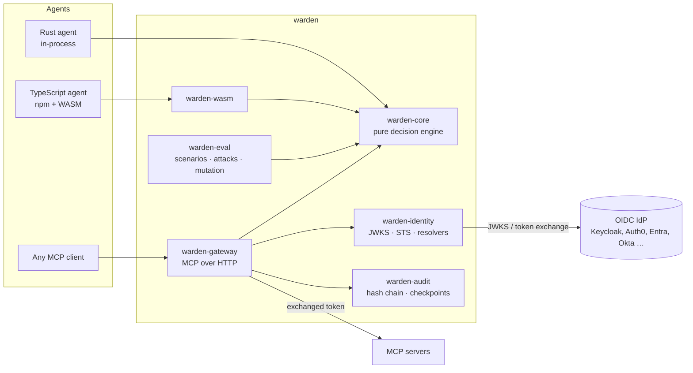
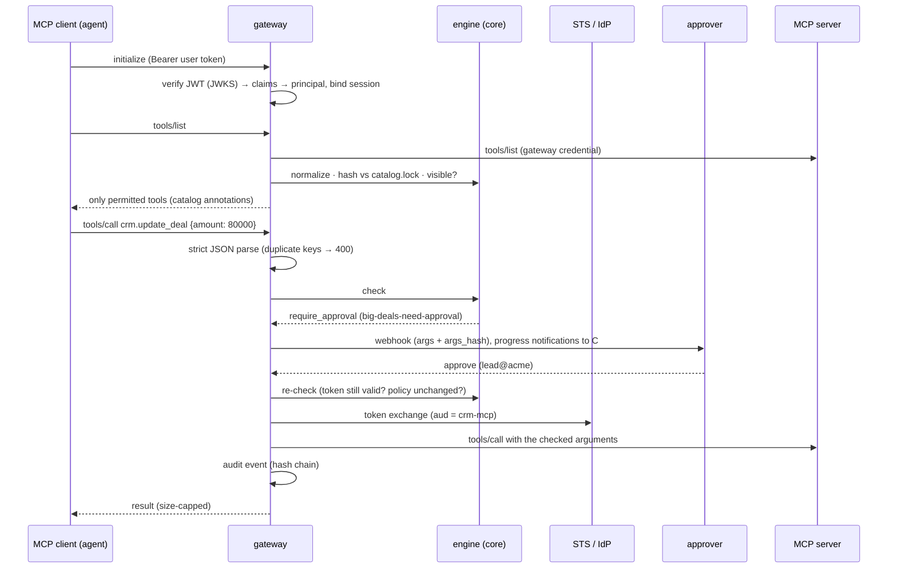

# Architecture

Warden answers one question — *may this agent, acting for this subject, perform this
action right now?* — in a way the model cannot influence. This page explains how the pieces
fit together.

## Layers



| Crate | Responsibility | I/O? |
|---|---|---|
| `warden-core` | model, catalog, policy, normalization, constraints, delegation, claims → principal, lint, decision + trace | **none** (no clock, no network) |
| `warden-identity` | JWT signature verification (OIDC discovery, JWKS cache, kid-flood protection), token-exchange STS with delegation chains, attribute resolvers | HTTP |
| `warden-audit` | hash-chained JSONL sink, HMAC'd arguments, Ed25519 checkpoints, verifier, tracing sink | files |
| `warden-mcp` | JSON-RPC/MCP helpers, Streamable HTTP client, SSE parser | HTTP |
| `warden-gateway` | the enforcement point: sessions, list filtering, call enforcement, approvals, pinning, kill switch, hot reload, admin API | HTTP |
| `warden-eval` | scenario runner, attack generator, policy mutation testing, CI gates | none |
| `warden-cli` | `warden` binary (lint, explain, eval, audit, catalog, dev STS, demo) | — |
| `warden-wasm` + `packages/warden` | the core for TypeScript, plus guards and adapters | — |

The core being pure is the central design decision: it is what lets the same engine run in
the gateway, inside a Rust agent and in Node/Browser via WebAssembly, with one set of
conformance vectors proving they agree.

## The decision

```text
effective  = scopes(subject.roles) ∩ agent.max ∩ token.scopes ∩ ⋂ actor.max   (for every agent in the act chain)
decision   = scope_gate(effective, catalog[action]) → rules (restrict only) → effect
```

Evaluation order is fixed:

1. **Normalize** the action name (NFKC → lowercase → ASCII allowlist) or URI (decode once,
   reject `..`, empty segments, double encoding) and check argument size/depth.
2. **Principal**: the agent is known, every delegation edge is allowed (`may_delegate_to`),
   the chain is not deeper than `max_depth`, service subjects are allowed.
3. **Kill switch** `all`.
4. **Catalog**: no entry (or an entry without scopes) → deny. If the kind is pinned in
   `catalog.lock`, the definition hash must match.
5. **Kill switch** `writes` for write actions.
6. **Scope gate**: every scope the catalog requires must be granted by a role, by the agent's
   `max`, by the token, and by every delegating agent.
7. **Rules**: every matching rule is evaluated. `require` denies when its condition is false,
   `approve_if` asks for approval when true, `deny_if` denies when true. A missing argument,
   wrong type, invisible character or unresolvable placeholder is *unknown* → deny.
8. **Combine**: deny > require_approval > allow.

Rules can only narrow what scopes grant; there is no `allow` rule. That makes the policy
monotonic and reviewable: adding a rule can never open access.

## Request flow through the gateway



## Identity

* The gateway verifies only signatures itself; issuer, audience, expiry, token type,
  delegation chain and claim mapping happen in the core (`principal_from_claims`). TypeScript
  uses `jose` for the signature and the same WASM function for the rest.
* Claim mapping is declarative JSON-Pointer YAML. Presets for Keycloak, Auth0, Entra ID,
  Okta and generic OIDC live in `crates/warden-core/presets/`.
* Most IdPs cannot issue RFC 8693 `act` chains, so `warden-identity` contains a small
  STS. An agent exchanges the user's token with `delegate_to=<agent>`; the STS checks the
  policy's delegation edges and signs a short-lived token whose `act` chain records every
  delegating agent. The engine re-checks the chain anyway.
* Revocation: issuers with `introspection:` are asked (RFC 7662, cached for `cache_s`) on top of
  local JWT verification; `warden sts` implements `/introspect` and `/revoke`, including
  revoke-by-subject.
* Upstreams never see the client's token: the gateway uses client credentials or token
  exchange (narrower audience, same subject and chain).

## Audit

Each gateway instance writes its own chain (`<chain>-<date>.jsonl`). Every event contains
`prev` and `hash = sha256(prev ‖ canonical_json(event))`. Every N events a checkpoint event
signs the current head with Ed25519, so a full recomputation of the chain is detectable.
Arguments are stored as HMAC-SHA256; clear text is opt-in per catalog entry and never for
`pii`-tagged actions. If the sink fails, the action is denied.

## Extension points

| Extension | Trait / format | Shipped implementations |
|---|---|---|
| Identity provider | `mapping:` YAML (JSON pointers) | keycloak, auth0, entra-id, okta, generic-oidc |
| Attributes from elsewhere | `AttributeResolver` | static YAML, HTTP JSON (cached) |
| Approvals | `Approver` / webhook protocol v1 | webhook (HMAC-signed), deny-all, auto-approve (dev only) |
| Audit | `AuditSink` | JSONL hash chain, OTLP logs, stdout, tracing, memory, multi |
| Upstream transport | `url:` or `command:` | Streamable HTTP, stdio (child process, env allow-list) |
| Upstream credentials | `UpstreamAuth` | token exchange, client credentials, static, none |
| Argument checks | `CustomConstraint` (Rust) | built-in: equals, in, glob, regex, min, max, not_in_range, sql |
| Agent frameworks | adapters | MCP gateway, TS `guard()`, MCP server wrapper, Vercel AI SDK |

Every extension's failure path is a deny.
